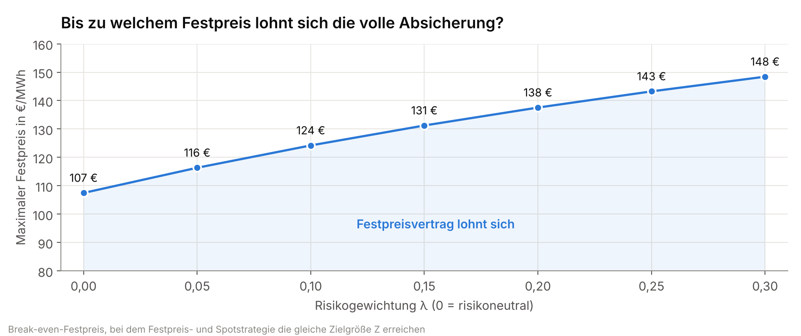
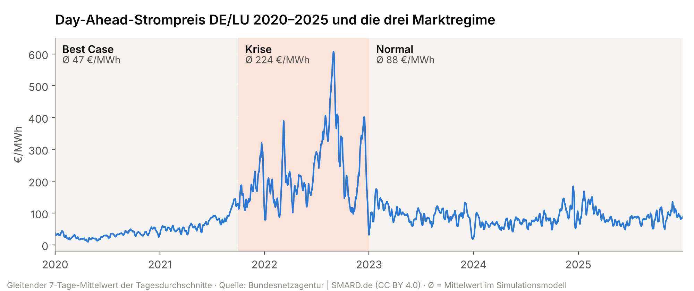
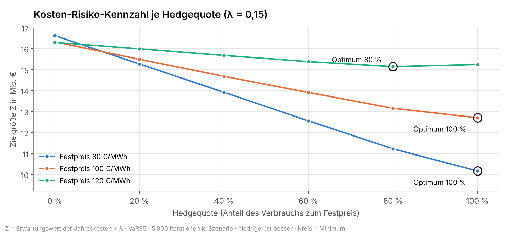
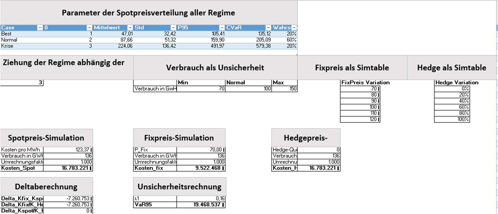
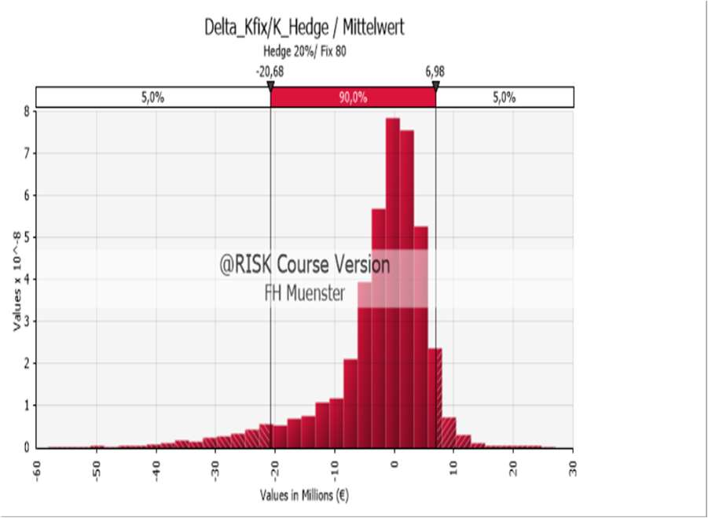
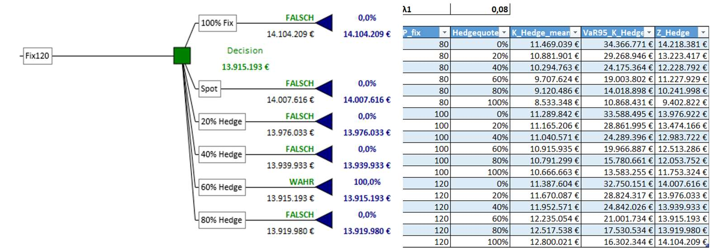

# Strombeschaffung unter Preisunsicherheit – Monte-Carlo-Simulation

**Kontext:** Hausarbeit im Modul Management Science, Master Wirtschaftsingenieurwesen, FH Münster (März 2026), Einzelarbeit
**Werkzeuge:** Excel · Power Query · Palisade @RISK (Monte-Carlo) · PrecisionTree (Entscheidungsbaum) · TopRank (Sensitivität)

## Fragestellung

Ein Industrieunternehmen muss seinen Jahresstrom beschaffen. Es kann am Spotmarkt kaufen, einen Festpreisvertrag abschließen oder beides mischen (Hedging).
**Welche Strategie ist wirtschaftlich sinnvoll, und ab welchem Festpreis kippt die Entscheidung?**

## Ergebnis auf einen Blick

- **Break-even-Festpreis:** Ohne Risikoaufschlag lohnt sich ein Festpreisvertrag bis rund **107 €/MWh**. Wer Preisspitzen stärker gewichtet (λ = 0,15), sollte bis rund **131 €/MWh** absichern.
- **Bei 80 und 100 €/MWh** ist die volle Absicherung über den Festpreis in jedem betrachteten Risikoszenario optimal.
- **Bei 120 €/MWh** hängt die beste Hedgequote von der Risikobereitschaft ab: 0 % bei risikoneutraler Sicht, 60–80 % bei mittlerer und 100 % bei hoher Risikoaversion.
- **Größter Einflussfaktor** auf die Beschaffungskosten ist der Verbrauch, danach folgen Marktregime und Festpreis.

## Daten

| | |
|---|---|
| Quelle | Bundesnetzagentur, [SMARD.de](https://www.smard.de) – Großhandelspreise Day-Ahead |
| Inhalt | Stündliche Strompreise Deutschland/Luxemburg in €/MWh |
| Zeitraum | 01.01.2020 – 31.12.2025, **52.608 Stundenwerte** |
| Lizenz | CC BY 4.0 – Rohdaten liegen unverändert in [`daten/`](daten/) |

## Vorgehen

**1. Datenaufbereitung:** Import per Power Query, Ableitung von Jahr, Monat, Wochentag und Stunde, Kennzeichnung von Peak/Off-Peak und der Energiekrise. Das Workbook enthält ein ReadMe und ein Data Dictionary.

**2. Marktregime:** Der Zeitraum wurde in drei Phasen geteilt und je Phase eine Regression mit Stunden- und Monats-Dummies gerechnet (Excel `RGP`, `MMULT`). Die Residuen zeigen, wie stark die Preise jenseits der normalen Tages- und Saisonmuster schwanken. In der Krise ist die Streuung rund fünfmal so hoch wie im Best Case.

**3. Monte-Carlo-Simulation (@RISK):** Je Iteration werden drei Zufallsgrößen gezogen:

| Zufallsgröße | Annahme |
|---|---|
| Marktregime | Best 20 % · Normal 60 % · Krise 20 % |
| Spotpreis | Normalverteilung je Regime (Ø 47 / 88 / 224 €/MWh) |
| Jahresverbrauch | Dreiecksverteilung 70 / 100 / 150 GWh |

Simuliert wurden 5.000 Iterationen je Szenario: Festpreise 80, 100 und 120 €/MWh, jeweils mit Hedgequoten von 0 bis 100 % in 20-%-Schritten, zusätzlich die reine Festpreisstrategie von 70 bis 120 €/MWh.

**4. Entscheidungsregel:** Nur die Durchschnittskosten zu minimieren reicht nicht, denn ein einziges Krisenjahr kann teuer werden. Deshalb wird jede Strategie über eine Kennzahl bewertet, die Kosten und Risiko verbindet:

> **Z = Erwartungswert der Jahreskosten + λ · VaR95**
> λ steuert die Risikobereitschaft: 0 = nur Durchschnittskosten, höher = Extremkosten wiegen schwerer.

**5. Sensitivität und Entscheidungsbaum:** Mit TopRank wurde geprüft, welche Eingangsgröße die Kosten am stärksten bewegt. Mit PrecisionTree wurden die Ergebnisse als Entscheidungsbaum visualisiert.

## Entscheidungstabelle

| λ | Festpreis 80 €/MWh | Festpreis 100 €/MWh | Festpreis 120 €/MWh |
|---|---|---|---|
| 0,00 (risikoneutral) | 100 % Festpreis | 100 % Festpreis | 0 % (reiner Spotmarkt) |
| 0,08 | 100 % | 100 % | 60 % |
| 0,16 | 100 % | 100 % | 80 % |
| 0,24 | 100 % | 100 % | 100 % |

**Handlungsempfehlung:** Liegt das Festpreisangebot unter dem erwarteten Spotpreis von rund 107 €/MWh, sollte voll abgesichert werden. Liegt es darüber, entscheidet die Risikobereitschaft des Unternehmens über die Hedgequote. Die Tabelle liefert dafür eine direkt nutzbare Regel.

## Einblick ins Modell

<table>
<tr>
<td width="50%"> Aufbau des Simulationsmodells in Excel</td>
<td width="50%"> @RISK: Kostendifferenz Festpreis vs. Hedge (Hedge 20 %, Fix 80 €)</td>
</tr>
<tr>
<td colspan="2"> PrecisionTree: Entscheidungsbaum für 120 €/MWh bei λ = 0,08</td>
</tr>
</table>

## Grenzen

- Die Spotpreise sind je Regime normalverteilt modelliert. Echte Strompreise haben stärkere Ausreißer.
- Regime-Wahrscheinlichkeiten und Verbrauchsspanne sind plausible Annahmen, keine Unternehmensdaten.
- Terminmarktpreise, Lastprofile und regulatorische Änderungen sind nicht berücksichtigt.

## Dateien

| Datei | Inhalt |
|---|---|
| [`modell/Simulationsmodell.xlsx`](modell/Simulationsmodell.xlsx) | Komplettes Modell: ReadMe, Data Dictionary, Rohdaten, Regime-Regressionen, Monte-Carlo-Simulation, Ergebnis- und Entscheidungstabelle |
| [`modell/Entscheidungsbaum.xlsx`](modell/Entscheidungsbaum.xlsx) | Entscheidungsbaum (PrecisionTree) |
| [`daten/`](daten/) | SMARD-Rohdaten als CSV |

> Hinweis: Die Excel-Dateien lassen sich ohne Zusatzsoftware öffnen, die Ergebnisse sind gespeichert. Für eine erneute Simulation ist Palisade @RISK erforderlich.
