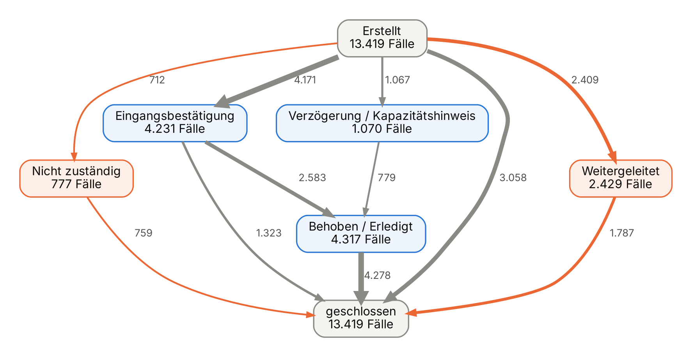
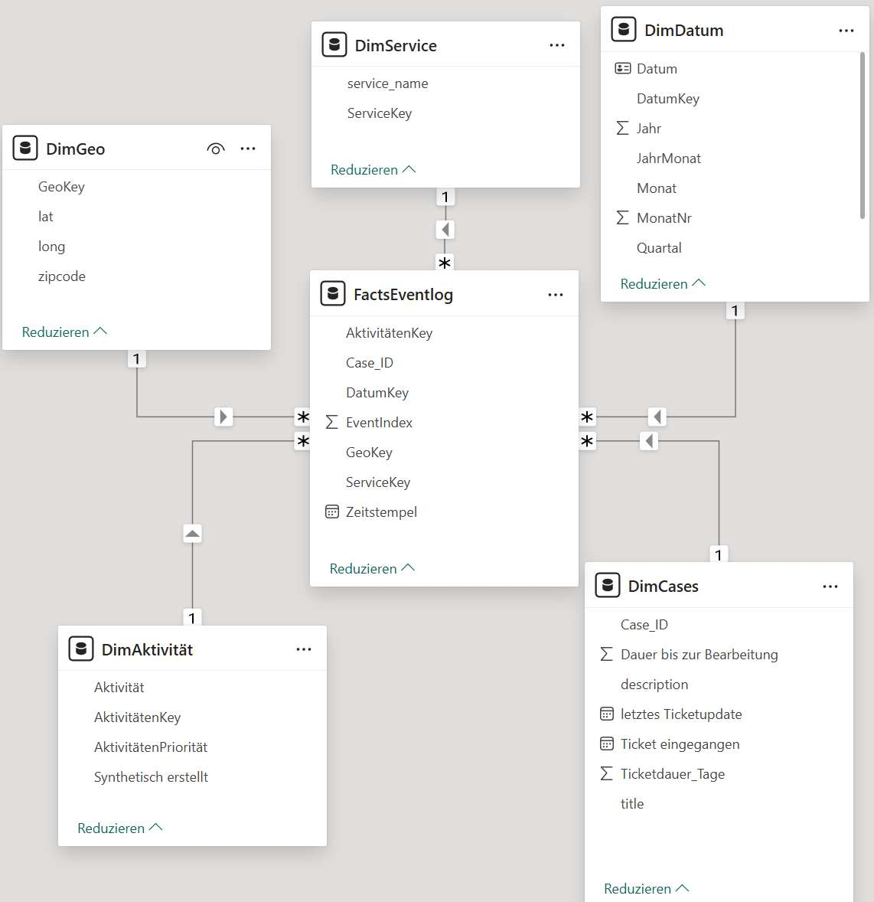
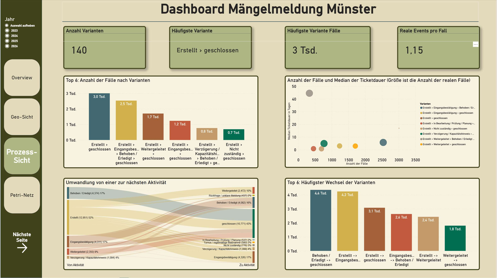
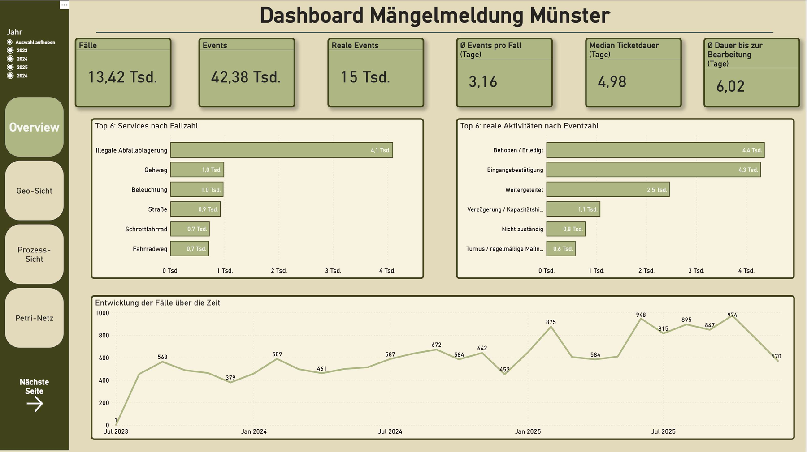
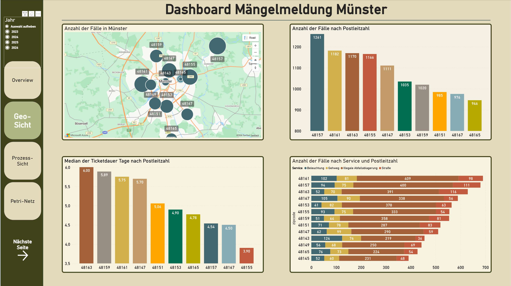

# Process Mining: Mängelmelder der Stadt Münster

**Kontext:** Hausarbeit im Modul Business Intelligence, Master Wirtschaftsingenieurwesen, FH Münster (März 2026), Einzelarbeit
**Werkzeuge:** Excel · Power Query (M) · Power BI (Datenmodell, DAX-Measures, Dashboard)

## Fragestellung

Bürgerinnen und Bürger melden Schäden und Missstände über den Online-Mängelmelder der Stadt Münster, zum Beispiel illegale Müllablagerungen, defekte Laternen oder Schlaglöcher. Die Stadt bearbeitet die Meldungen und antwortet im Portal.
**Wie läuft diese Bearbeitung tatsächlich ab, welche Prozessvarianten gibt es, und wo geht Zeit verloren?**

Die Schwierigkeit: Es gibt kein fertiges Prozessprotokoll. Die einzelnen Bearbeitungsschritte mussten aus den Freitext-Antworten der Verwaltung rekonstruiert werden.

## Ergebnis auf einen Blick

- **13.419 Meldungen** aus 07/2023 bis 12/2025 als Prozess rekonstruiert, mit 42.181 Events.
- **Typischer Ablauf:** Eingangsbestätigung → Behoben, bei 19 % aller Fälle. Der Median der Ticketdauer liegt bei **5 Tagen**.
- **Weiterleitungen kosten Zeit:** 18 % der Meldungen werden an eine andere Stelle weitergeleitet. Werden sie danach behoben, dauert es im Median **rund 45 Tage**, also neunmal so lange wie der typische Fall.
- **Dokumentationslücke:** 22 % der Fälle enthalten keinen einzigen dokumentierten Bearbeitungsschritt und werden im Median erst nach **17 Tagen** geschlossen. Für Bürger ist hier nicht sichtbar, was passiert.
- **Wenige Themen dominieren:** Illegale Abfallablagerung macht 31 % aller Meldungen aus. Infrastrukturthemen wie Gehweg, Straße oder Radweg dauern mit 19–34 Tagen deutlich länger.

**Ansatzpunkte:** Meldungen schon bei der Eingabe der zuständigen Stelle zuordnen (weniger Weiterleitungen) und für jede Meldung mindestens eine Rückmeldung an den Bürger sicherstellen.

Prozesslandkarte aus dem Eventlog: Übergänge mit mindestens 700 Fällen. Orange = Weiterleitung oder Abweisung.

## Vorgehen

**1. Datenbeschaffung über die API:** Die Stadt stellt die Daten über eine [Open311-Schnittstelle](https://ckan.open.nrw.de/dataset/daten-des-mangelmelder-munster-ms) bereit. Pro Abruf liefert sie höchstens 1.000 Datensätze und lässt sich nur nach Datum filtern. Deshalb wurden die Daten monatsweise abgerufen und zu **18.360 Datensätzen** zusammengeführt.

**2. Bereinigung und Aktivitäts-Mapping (Power Query):** Zeitstempel mit Zeitzonen wurden vereinheitlicht und Dauerkennzahlen berechnet. Kernstück ist ein Regelwerk, das die Freitext-Antworten der Verwaltung einer von **12 Aktivitätsklassen** zuordnet, zum Beispiel „Weitergeleitet“, „Nicht zuständig“ oder „Behoben / Erledigt“. Das Regelwerk wurde mit KI-Unterstützung entworfen und anschließend von mir manuell gegen die tatsächlichen Formulierungen geprüft und nachgeschärft. Die übrige Aufbereitung, das Eventlog, das Datenmodell und das Dashboard habe ich eigenständig in Power Query und Power BI umgesetzt.

**3. Eventlog:** Process Mining braucht je Fall eine zeitlich geordnete Folge aus Case-ID, Zeitstempel und Aktivität. Da das Quellsystem Beginn und Ende nicht als Ereignis protokolliert, wurden je Fall ein Start-Event („Erstellt“) und ein End-Event („geschlossen“) ergänzt. Eine Sortier-Priorität und ein Event-Index sorgen für eine stabile Reihenfolge bei gleichen Zeitstempeln. Mit Pivot-Prüfungen wurde kontrolliert, dass jeder Fall genau ein Start- und ein End-Event hat.

**4. Datenmodell (Power BI):** Sternschema mit dem Eventlog als Faktentabelle und den Dimensionen Fall, Service, Geo, Aktivität und Datum.

**5. Dashboard:** Drei Sichten: Überblick, regionale Verteilung nach Postleitzahl und Prozesssicht mit Varianten, Übergängen und Durchlaufzeiten.

## Dashboard

**Prozesssicht:** Varianten, Übergänge, Häufigkeit vs. Ticketdauer

<b>Überblick und Geo-Sicht anzeigen</b>

## Grenzen

- Das Eventlog stützt sich auf öffentliche Rückmeldungen, nicht auf interne Systemprotokolle. Nicht jeder reale Arbeitsschritt ist dokumentiert.
- Die Ticketdauer misst die Zeit vom Eingang bis zum letzten Update der Meldung.
- Die Zuordnung von Freitexten zu Aktivitäten ist regelbasiert. Einzelne Fehlzuordnungen sind möglich, die Klasse „Sonstiges“ betrifft rund 2,5 % der Fälle.

## Dateien

| Ordner | Inhalt |
|---|---|
| [`power-query/`](power-query/) | M-Code der Aufbereitung: Aktivitäts-Mapping, Bereinigung, Start-, reale und End-Events, Eventlog |
| [`daten/`](daten/) | Aggregierte Ergebnistabellen: Prozessvarianten, direkte Übergänge, Fälle nach Service, Postleitzahl und Monat, Aktivitätsklassen |
| [`bilder/`](bilder/) | Dashboard-Screenshots, Sternschema, Prozesslandkarte |

> **Datenschutz:** Die Rohdaten enthalten Freitexte von Bürgerinnen und Bürgern sowie Adressen. Für den Datensatz ist keine offene Lizenz angegeben. Deshalb liegen hier bewusst keine Einzelmeldungen und keine Power-BI-Datei, sondern nur der Code und aggregierte Ergebnisse ohne Personenbezug. Die Rohdaten sind über die oben verlinkte Schnittstelle der Stadt abrufbar.
