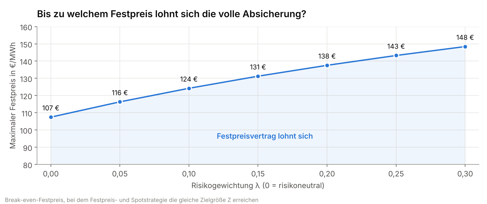
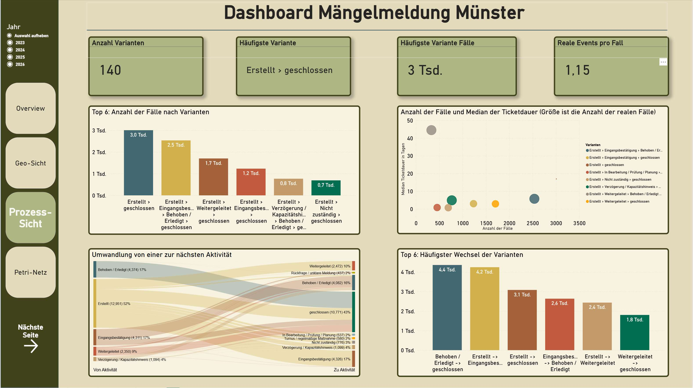

# Projektportfolio – Fabian Barth

**Wirtschaftsingenieur (B.Sc.) · Masterstudent Wirtschaftsingenieurwesen, FH Münster (Abschluss voraussichtlich 07/2027)**

Ich analysiere betriebliche Daten und Geschäftsprozesse, erkenne Verbesserungspotenziale und entwickle daraus fundierte Entscheidungsgrundlagen und praxisnahe Lösungen.

Dieses Repository zeigt zwei Projekte aus meinem Masterstudium. Beide basieren auf echten, öffentlich verfügbaren Daten und sind als kurze Fallstudien aufbereitet: Fragestellung, Vorgehen, Ergebnis.

---

## Projekte auf einen Blick

| | Projekt | Fragestellung | Kernergebnis | Methoden & Werkzeuge |
|---|---|---|---|---|
| **1** | [**Strombeschaffung unter Preisunsicherheit**](01-strombeschaffung-monte-carlo/) | Festpreis, Spotmarkt oder Mischung: Welche Beschaffungsstrategie ist wirtschaftlich sinnvoll? | Ein Festpreisvertrag lohnt sich risikoneutral bis rund **107 €/MWh**, mit Risikogewichtung bis rund **131 €/MWh**. Darüber ist eine Teilabsicherung optimal. | Monte-Carlo-Simulation, Szenarioanalyse, Value at Risk, Entscheidungsbaum · Excel, Power Query, Palisade @RISK, PrecisionTree, TopRank |
| **2** | [**Process Mining: Mängelmelder Münster**](02-process-mining-maengelmelder/) | Wie werden Bürgermeldungen bei der Stadt tatsächlich bearbeitet, und wo geht Zeit verloren? | 13.419 Fälle als Prozess rekonstruiert. Median der Ticketdauer: 5 Tage. Wird eine Meldung erst weitergeleitet und dann behoben, sind es rund **45 Tage**. | API-Datenextraktion, ETL, Eventlog-Aufbau, Sternschema, Process Mining · Power Query (M), Power BI |

<p>
  <a href="01-strombeschaffung-monte-carlo/"></a>
  <a href="02-process-mining-maengelmelder/"></a>
</p>

---

## Was die Projekte zeigen

| Fähigkeit | Nachweis |
|---|---|
| **Datenbasierte Entscheidungsunterstützung** | Entscheidungsregel für die Strombeschaffung, abhängig von Festpreis und Risikobereitschaft (Projekt 1) |
| **Quantitative Modellierung unter Unsicherheit** | Monte-Carlo-Simulation mit 5.000 Iterationen je Szenario, VaR95 als Risikomaß, Sensitivitätsanalyse (Projekt 1) |
| **Datenaufbereitung (ETL)** | 52.608 Stundenwerte strukturiert (Projekt 1) · 18.360 Datensätze per API in Monatsblöcken extrahiert und bereinigt (Projekt 2) |
| **Prozessanalyse & Process Mining** | Eventlog aus Freitexten rekonstruiert, Prozessvarianten und Übergänge ausgewertet (Projekt 2) |
| **Business Intelligence** | Sternschema und Dashboard mit drei Sichten in Power BI (Projekt 2) |
| **Ergebnisse verständlich aufbereiten** | Kennzahlen, Visualisierungen und klare Handlungsempfehlungen in beiden Projekten |

---

## Aufbau des Repositorys

```
01-strombeschaffung-monte-carlo/   Fallstudie, Simulationsmodell (Excel), Entscheidungsbaum, SMARD-Rohdaten
02-process-mining-maengelmelder/   Fallstudie, Power-Query-Code, aggregierte Ergebnistabellen, Dashboard-Screenshots
```

Beide Projekte sind Einzelarbeiten aus dem Masterstudium an der FH Münster (Wintersemester 2025/26).
